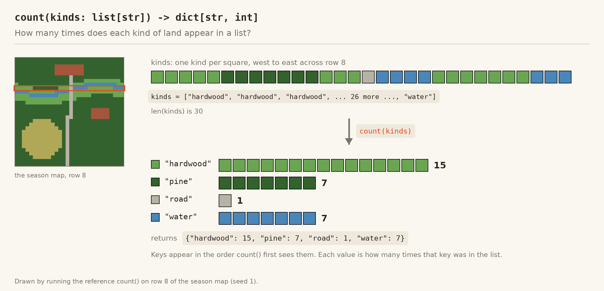
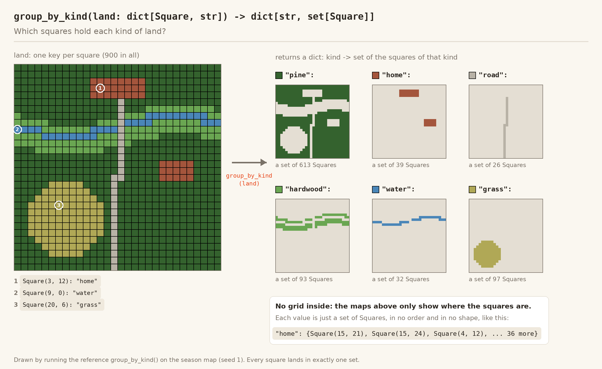
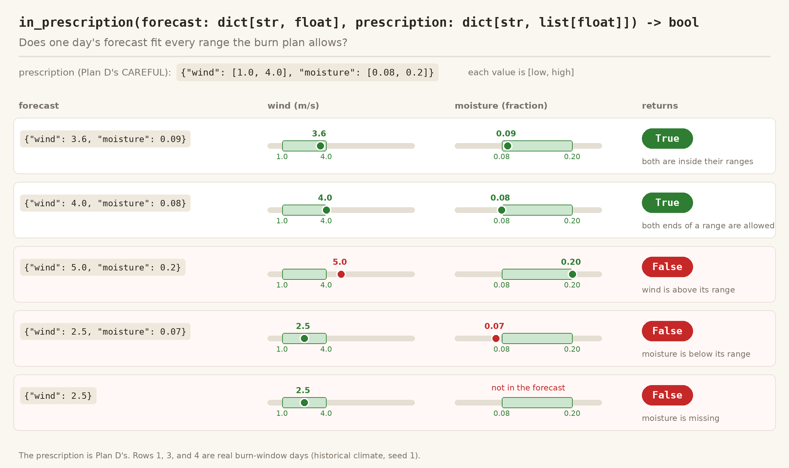
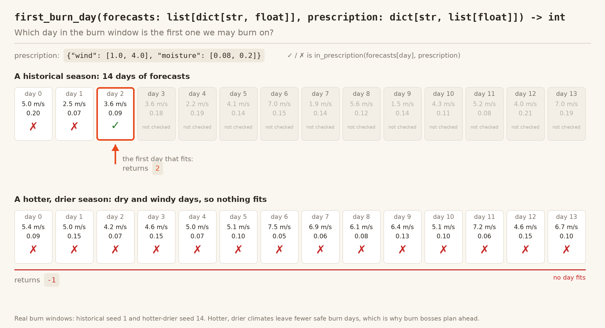
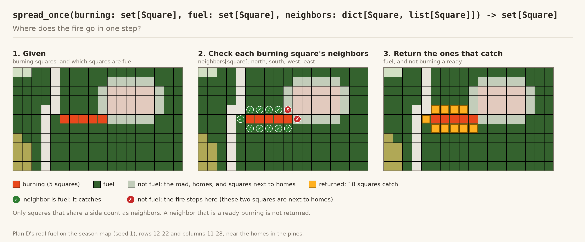
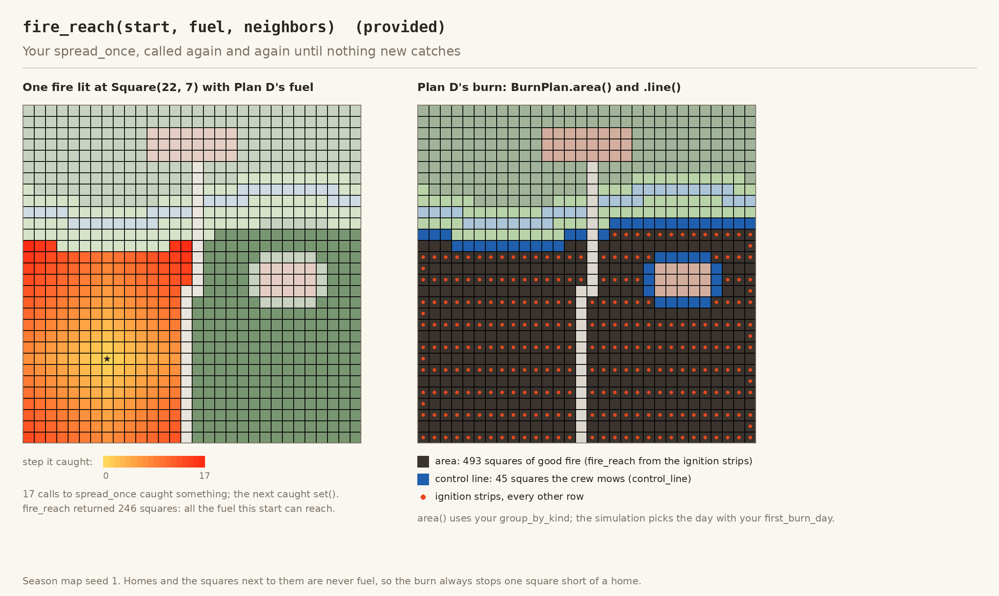

# Good Fire — Part 2 (EX06): Plan a Prescribed Burn

> **Finish Good Fire Part 1 (EX05) before you start Part 2 (EX06).** Part 2
> runs on your Part 1 code: your `cover.py`, `sketch.py`, and
> `landscape.py`. If any Part 1 method is unfinished, the 3D app and
> `compare_plans.py` stop with a `NotImplementedError` from your Part 1
> files.

## The story

You are now on a fire-management team. Your landscape is the one from
Part 1: longleaf pine uplands, hardwoods along the river, an old-field
meadow, a county road, and two neighborhoods where homes meet the woods.

Longleaf pine and wiregrass need fire. They evolved with low-intensity
fire every few years, and without it, brush and hardwoods crowd in and
dead needles pile up into fuel for an intense wildfire. So before the
wildfire season, your team will conduct prescribed fires (**good fires**) on the land. The fire has a job to do, and it has to stay where it
belongs. It should burn the pine and grass, stay out of the bottomland
hardwoods, and above all stay away from homes.

Real burn bosses write a **burn plan** before they light anything:

* **The burn unit**: the area to burn, drawn on a map.
* **The fuels to burn**: here, the pine and the grass.
* **Control lines**: wherever fire could leave those fuels, the crew mows
  or disks a strip down to bare soil. Roads and rivers already stop fire,
  so a smart unit uses them as free *anchors*.
* **A prescription**: the range of weather the burn is allowed in. Too
  damp, and the fire goes out. Too dry or too windy, and embers fly over
  the line.
* **An ignition pattern**: where the crew lights the fire.

You will write the code behind that plan, then choose the best of five
season plans. In the 3D
view, your burn day plays out first. Then months pass, the burned ground
greens up with only a light load of fuel, and the wildfire season begins.
You will see whether your good fire helps protect the homes.

You will plan under two climates. "Historical" weather has a moderate south
breeze over typically damp fuel. "Hotter, drier" weather is the kind a
warming climate makes more common: stronger wind over drought-dry fuel.
That affects both halves of the season. There are fewer calm, damp days
to burn on, and the wildfires that follow are fiercer.

## What you will practice

**Your functions work on plain data.** You never touch the map or the
fire. The provided code turns the map into lists, sets, and dictionaries,
calls your functions, and uses what they return.

* A **kind of land** is a string: `"pine"`, `"grass"`, `"hardwood"`,
  `"home"`, `"water"`, `"road"`, or `"cleared"`.
* A **`Square`** is a label for one place on the map. You never need to
  look inside one. Put `Square`s in sets, use them as dictionary keys, and
  compare them with `==` and `in`. Two `Square`s for the same place are
  equal:

  ```python
  burned: set[Square] = {Square(3, 4), Square(3, 5)}
  Square(3, 4) in burned  # True: a different object, but the same place
  ```

* A **land map** is a `dict[Square, str]`: the kind of land on each
  square.
* A **neighbors map** is a `dict[Square, list[Square]]`: for each square,
  the squares right next to it (north, south, west, and east), where fire
  can spread next.

## The science

Fire spreads from square to square following a published model
(Alexandridis et al. 2008), with fuel moisture damping in the spirit of
Rothermel (1972). Three things matter most:

* **Wind**: fire races downwind. A **backing fire**, one that creeps into
  the wind, is slow and gentle. Burn-day winds blow toward the north.
* **Slope**: fire runs uphill, and the north (row 0) is uphill.
* **Fuel moisture**: damp fuel burns slowly, and at 30% moisture it does
  not burn at all.

**Embers** fly 3-10 squares downwind and can start spot fires, which can
throw more embers. They start up to 90% of home ignitions (IBHS), which is
why Firewise home hardening matters. On a burn day, a holding crew puts out
most spot fires outside the burn area, but the windier the day, the more
get away.

**The burn window** is two weeks of daily forecasts. The burn happens on
the first day that fits the prescription; if none fits, there is no burn.

The holding crew, burn window, and costs are teaching values, and our crew
lights its whole ignition line at once (real crews light strips one after
another).

## Setup

To load the latest changes for EX06:

1. Open the full COMP110 workspace by opening `workspace.code-workspace`.
2. Choose **Terminal → Run Task… Sync all workspace projects** under the
   support folder.
3. Wait for the terminal to finish. It has succeeded when it ends with:
   Everything is ready. You can start working!

   Part 2 only *adds* files to your `goodfire` folder; your Part 1
   `cover.py`, `sketch.py`, and `landscape.py` stay exactly as you left
   them.
4. Open `goodfire` and use **Terminal → Run Task…** to pick a Good Fire
   task:
   * **Good Fire: 3D Season (your chosen plan)**, and the **hotter and
     drier** and **no plan** versions
   * **Good Fire: 3D Season, Choose a Plan...** and **Good Fire: Compare
     One Plan...**, which ask which plan (A to E) to show
   * **Good Fire: Compare the Plans**
   * **Create EX06 - Good Fire Part 2 Submission**

   Or, in a terminal in the `goodfire` folder:

   ```sh
   uv run python app3d.py                  # your chosen plan, historical climate
   uv run python app3d.py --hotter-drier   # your chosen plan, hotter and drier
   uv run python app3d.py --plan B         # watch plan B instead
   uv run python app3d.py --no-plan        # the same season with no plan
   uv run python compare_plans.py          # compare all five plans
   uv run python -m pytest checks          # run the checks
   ```

3D controls: click the land to light a fire · Space pause · S one step ·
R restart · Up/Down speed · right-drag to orbit · scroll to zoom. Hover over
any square to see its `str()`.

## Your tasks

You edit two files, `goodfire/burnplan.py` and `goodfire/plan.py`. As
before, each needs a module docstring, `__author__`, and type annotations.
Code that is already written is a provided worked example; each
`raise NotImplementedError("TODO: ...")` is yours to replace.

### Step 1: the burn plan (`burnplan.py`)

Write the five functions at the top of `burnplan.py`. Each one works only
on the values it is given, and none of them should change the lists, sets,
or dictionaries they are given. Test each one as you go: `uv run python -m pytest checks`
runs the provided checks.

#### 1.1: `count`

**`count(kinds: list[str]) -> dict[str, int]`**

* **Takes** a list of kinds of land, one string per square, like the
  squares along a row of the map or along a control line.
* **Returns** a dictionary from each kind to how many times it appears.
  A kind that is not in the list is not a key.
* **Why:** before a crew commits to a burn, they want to know what it
  touches: how much is pine, how much is hardwood, and whether any homes
  are in the way. `compare_plans.py` uses your `count` to report what
  burned off target on a burn day (for example, `12 home`), so you can see
  why a plan went wrong.
* **How:** start with an empty dictionary. Loop through the list; if a
  kind is already a key, add 1 to its value, otherwise give it the value 1.

```python
count(["pine", "pine", "home"])  # returns {"pine": 2, "home": 1}
count([])  # returns {}
```




#### 1.2: `group_by_kind`

**`group_by_kind(land: dict[Square, str]) -> dict[str, set[Square]]`**

* **Takes** a land map: a dictionary from each `Square` to the kind of land
  on it.
* **Returns** the same information turned around: a dictionary from each
  kind of land to the set of `Square`s that hold it.
* **Why:** a land map answers "what is on this square?", but a burn plan
  needs the opposite question answered: "where are all the pines?" and
  "where are the homes?" `BurnPlan.area()` uses your groups to collect the
  fuel it means to burn and to find the homes it must stay away from. Each
  group is a set because a square either is in it or is not; order and
  repeats do not matter, and `in` is fast.
* **How:** loop through the keys of `land`. The first time you see a kind,
  give it an empty set (`set()`); then `add` the square to that kind's set.

```python
a: Square = Square(0, 0)
b: Square = Square(0, 1)
c: Square = Square(1, 0)
land: dict[Square, str] = {a: "pine", b: "home", c: "pine"}
group_by_kind(land)  # returns {"pine": {a, c}, "home": {b}}
```




#### 1.3: `in_prescription`

**`in_prescription(forecast: dict[str, float], prescription: dict[str,
list[float]]) -> bool`**

**What is a prescription?** Every real burn plan includes a
*prescription*: the range of weather the crew is allowed to burn in, agreed
on before anyone lights a match. If the day's weather is outside any one
range, the burn waits. In this project a prescription is a dictionary. Each
key names a weather condition, and each value is a two-item list
`[low, high]`: the lowest and highest values allowed, both included.

```python
careful: dict[str, list[float]] = {"wind": [1.0, 4.0], "moisture": [0.08, 0.20]}
```

A forecast uses the same keys, with one value each:
`{"wind": 2.5, "moisture": 0.12}`. The two conditions in this project are:

| Condition | Unit | What it means | Too low | Too high |
| --- | --- | --- | --- | --- |
| `"wind"` | meters per second (1 m/s is about 2.2 mph) | how fast the wind blows; forecasts here run from about 1 to 9 m/s | not enough breeze to carry smoke away and keep the fire moving in a steady, predictable direction | flames run fast, and more embers fly over the control line, faster than the holding crew can catch them |
| `"moisture"` | a fraction of the fuel's dry weight (0.12 means 12% water) | how damp the dead needles and grass are; 0.30 (30%) is so wet that fire cannot spread | drought-dry fuel burns hot and fast, so the burn is harder to hold | the fire creeps, and on very damp days it goes out before it covers the unit |

So `careful` means: burn only when the wind is between 1 and 4 m/s *and*
the fuel is between 8% and 20% moisture. A wider prescription, like plan
B's `{"wind": [1.0, 9.0], "moisture": [0.04, 0.22]}`, fits almost any day,
but it allows windy, dry days when embers escape.

* **Takes** one day's forecast, a dictionary from each weather condition to
  its value (like `{"wind": 2.5, "moisture": 0.12}`), and a prescription, a
  dictionary from each condition to the `[low, high]` range the burn
  allows.
* **Returns** `True` if every condition the prescription names is in the
  forecast and inside its range (both ends are allowed), and `False`
  otherwise. Conditions in the forecast that the prescription does not
  name do not matter.
* **Why:** a burn boss lights fire only on a day that fits the
  prescription. Too windy, and embers fly over the control line; too damp,
  and the fire goes out; too dry, and it burns too hot. Because the
  prescription is a dictionary, it can name any conditions it likes, and
  your function works for all of them.
* **How:** loop through the conditions in the prescription. If one is
  missing from the forecast, or its value is below `low` or above `high`,
  return `False`. If the loop finishes, every condition fit: return `True`.

```python
rx: dict[str, list[float]] = {"wind": [1.0, 4.0], "moisture": [0.08, 0.2]}
in_prescription({"wind": 2.5, "moisture": 0.12}, rx)  # True
in_prescription({"wind": 4.0, "moisture": 0.08}, rx)  # True: ends count
in_prescription({"wind": 4.1, "moisture": 0.12}, rx)  # False: too windy
in_prescription({"wind": 2.5}, rx)  # False: no moisture
```




#### 1.4: `first_burn_day`

**`first_burn_day(forecasts: list[dict[str, float]], prescription: dict[str,
list[float]]) -> int`**

* **Takes** a list of daily forecasts, in order starting with day 0, and a
  prescription.
* **Returns** the index of the first day whose forecast fits the
  prescription, or `-1` if no day fits.
* **Why:** the crew has a two-week burn window and burns on the first good
  day. The simulation runs the burn on the day your function picks, and
  `-1` means there is no burn this season, which happens more often in a
  hotter, drier climate.
* **How:** loop through the forecasts with an index. Use your
  `in_prescription` on each one, and return the index as soon as one fits.
  If the loop finishes without a match, return `-1`.

```python
calm: dict[str, list[float]] = {"wind": [1.0, 4.0]}
days: list[dict[str, float]] = [{"wind": 6.0}, {"wind": 2.0}, {"wind": 3.0}]
first_burn_day(days, calm)  # returns 1
first_burn_day([{"wind": 6.0}], calm)  # returns -1
```




#### 1.5: `spread_once`

**`spread_once(burning: set[Square], fuel: set[Square], neighbors:
dict[Square, list[Square]]) -> set[Square]`**

* **Takes** the set of squares burning now, the set of squares that are
  fuel, and a neighbors map (for each square, the squares right next to it).
* **Returns** the set of squares the fire spreads to in one step: every
  neighbor of a burning square that is fuel and is not burning already.
* **Why:** this is the question at the heart of a burn plan: where can the
  fire go next? Repeating this one step until nothing new catches (the
  provided `fire_reach`, below) tells the crew every square the burn could
  reach, and so where the control line has to go.
* **How:** start with an empty set. For each burning square, look at each
  of its neighbors (`neighbors[square]`); if a neighbor is in `fuel` and
  not in `burning`, add it. The provided `control_line` at the bottom of
  the file has almost the same shape: read it first.

```python
# a - b - c   d    (a line of three squares, and d off on its own)
d: Square = Square(5, 5)
near: dict[Square, list[Square]] = {a: [b], b: [a, c], c: [b], d: []}
spread_once({a}, {a, b, c, d}, near)  # returns {b}
spread_once({a, b}, {a, b, c, d}, near)  # returns {c}
spread_once({a}, {a, c, d}, near)  # returns set(): b is not fuel
```




**Read `fire_reach`** (provided, right after `spread_once`). It uses your
`spread_once` to answer the bigger question: where could the fire reach
eventually? It starts with the start squares that are fuel, then calls
`spread_once` again and again, adding what catches, until a step catches
nothing new.

```python
fire_reach({a}, {a, b, c, d}, near)  # returns {a, b, c}: d is not connected
fire_reach({a}, {a, c, d}, near)  # returns {a}: b is not fuel
```




**See how the provided code uses them.** Read `control_line` and
`BurnPlan` at the bottom of `burnplan.py`. `BurnPlan.area()` groups the
whole map by kind (your `group_by_kind`), keeps the unit's squares of the
species to burn, takes away every home and every square next to a home,
and keeps what fire can reach from the ignition line (`fire_reach`, built
on your `spread_once`).
`control_line` finds every burnable square next to that area: fire can
leave only through those squares, so the crew mows a line there. The
simulation picks the burn day with your `first_burn_day`, and
`compare_plans.py` uses your `count` to report what burned off target.
Once all five work, the burn days in `compare_plans.py` and the 3D app
come to life.

### Step 2: choose a season plan (`plan.py`)

**Finish Step 1 first.** Plans A through D are built with your
`burnplan.py` functions. Until all five pass their checks
(`uv run python -m pytest checks`), those plans cannot run a burn day, so `compare_plans.py`
and the 3D app show them with no good fire and the comparison is
meaningless.

Your crew has five plans to choose from, in the provided `plans.py`. Each
one is a burn plan (built with your functions) plus tactics for the
wildfire season, all within one $40,000 budget:

| Plan | What it does |
| --- | --- |
| A | a small backing burn southeast of the road, and one fuel break |
| B | burn everything south of the river in strips on any day with wind up to 9 m/s, and Firewise the homes in the pines |
| C | burn everything south of the river in strips on a calm, damp day, with no Firewise work |
| D | burn everything south of the river in strips on a calm, damp day, and Firewise the homes in the pines |
| E | no burn: Firewise both neighborhoods and cut a fuel break |

Compare them:

```sh
uv run python compare_plans.py       # every plan over ten seasons, side by side
uv run python compare_plans.py B     # each season for plan B
uv run python app3d.py --plan B      # watch plan B in 3D
```

Then set `CHOSEN_PLAN` in `plan.py` to the letter of the plan that does
best on all three of these:

* **Habitat restored with good fire**: the more squares of pine and grass
  burned on burn days, the better.
* **The burn stays on target**: no home catches fire on a burn day, at
  most 30 squares burn off target, and the burn happens in at least 8 of
  the 10 seasons.
* **Homes kept safe** at the end of the season.

Before you choose, think about why each other plan falls short. What does
a backing fire alone accomplish? What happens to embers on a windy burn
day? Where do the homes in the pines sit, compared with the burn? And what
does a plan with no good fire give up?

Gradescope runs the plan you choose over the same 10 seasons
(5 seeds in both climates, 390 homes in all) and scores it:

| | Half credit | Full credit |
| --- | --- | --- |
| Habitat restored with good fire (squares) | 1,500 | 3,000 |
| The burn stays on target | | all three conditions above |
| Homes kept safe | 340 | 370 |

## Testing and submitting

Run **Terminal > Run Task... > Create EX06 - Good Fire Part 2 Submission**
task. It writes a ZIP with `goodfire/burnplan.py` and `goodfire/plan.py`
into the `goodfire` folder; upload that ZIP to EX06 on Gradescope.

Each function's points are split evenly across its test cases, so a
function that passes 4 of its 5 cases earns 4/5 of its points. When a case
fails, Gradescope shows the input, what your function returned, and often
a hint, plus the command that runs the same checks on your laptop.

## How it all fits together

You only edit `burnplan.py` and `plan.py`, but you are encouraged to read
the other files if you are curious how everything fits together: how the
map becomes plain data, how a burn day runs, and how the 3D view draws
it all.

| File | Yours? | What it holds |
| --- | --- | --- |
| `goodfire/cover.py`, `sketch.py`, `landscape.py` | from Part 1 | your Part 1 classes, unchanged |
| **`goodfire/burnplan.py`** | **yours** | five functions with sets and dictionaries; `fire_reach`, `control_line`, and `BurnPlan` are provided worked examples that use them |
| `goodfire/recursion.py` | provided | `spot_fire`: a worked example of recursion (an ember that starts a fire can throw another ember) |
| **`goodfire/plan.py`** | **yours** | `CHOSEN_PLAN`: the plan you choose |
| `goodfire/plans.py` | provided | the five season plans, A to E |
| `goodfire/fieldkit.py` | provided | turns the map into plain data (`land_map`, `neighbor_map`, `squares_of`) and other helpers |
| `goodfire/looks.py` | provided | gives every kind of square its `appearance()` for the 3D view |
| `goodfire/simulation.py` | provided | `Wildfire`: the burn day, then the season |
| `goodfire/weather.py`, `tactics.py` | provided | weather effects; fuel breaks, defensible space, water drops |
| `goodfire/part2_protocols.py`, `scenario.py` | provided | the protocols; the season's map, fires, budget, climates, and forecasts |
| `viewer3d.py`, `models3d.py`, `effects3d.py`, `app3d.py`, `compare_plans.py` | provided | the 3D sand table, and a side-by-side comparison of the plans |

The starter includes reference Part 1 files; your own Part 1 files work
too.

## Sources

Alexandridis et al. (2008); Rothermel (1972), USDA Forest Service
INT-115; Wade and Lunsford (1989), *A Guide for Prescribed Fire in Southern
Forests*, USDA Forest Service Southern Region, R8-TP 11; FARSITE technical
documentation on spotting; IBHS (2019); NFPA Firewise USA; The Nature
Conservancy NC and the NC Forest Service on longleaf pine and prescribed
fire; Petrasova et al. (2018), *Tangible Modeling with Open Source GIS*;
EPA Climate Change Indicators: Wildfires; Climate Central (2024).
